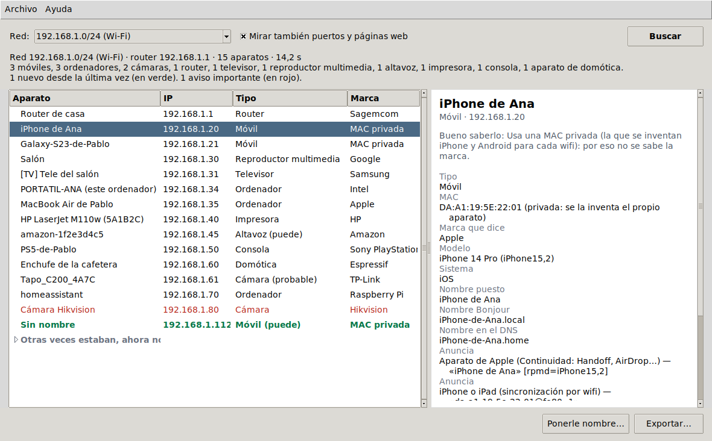
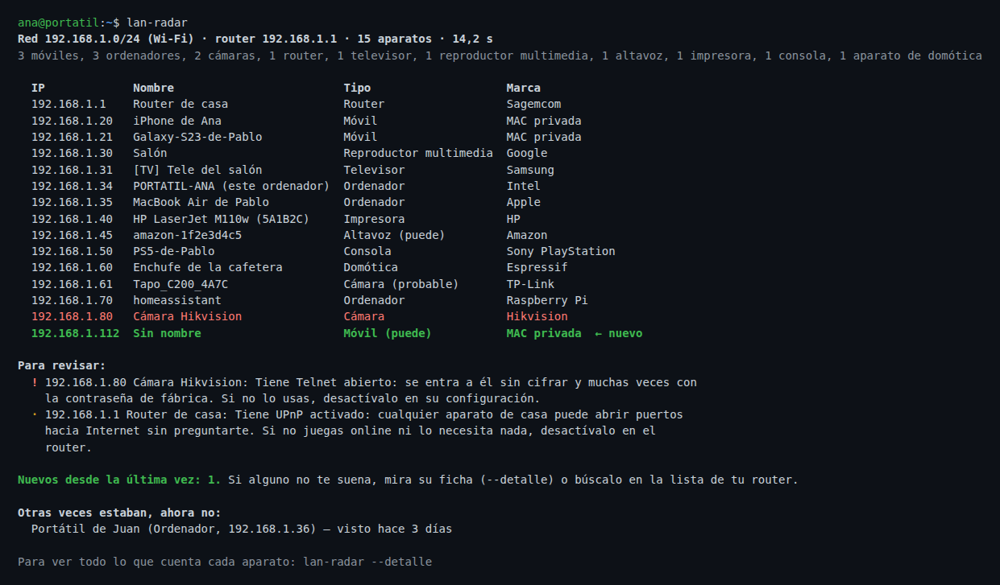

# lan-radar

[](https://github.com/espi0207/lan-radar/actions/workflows/ci.yml)
[](https://github.com/espi0207/lan-radar/actions/workflows/release.yml)

**¿Quién está en mi wifi?** lan-radar busca los aparatos conectados a la red de tu casa y
les pregunta quiénes son, como hace el móvil cuando busca la tele para mandarle un vídeo.
De cada uno saca todo lo que cuenta de sí mismo: la marca, el nombre que le pusiste, el
modelo, el sistema, lo que sabe hacer... Y con eso adivina qué es (móvil, tele,
impresora, cámara...) y te dice por qué lo cree.

Además se acuerda de lo que ha visto: te avisa de los aparatos **nuevos**, te dice cuáles
estaban otras veces y ahora no, y puedes ponerles nombre ("Enchufe de la cafetera") para
reconocerlos la próxima vez.



## Descargar

| Sistema | |
|---|---|
| **Windows** 10 y 11 | [Instalador (lan-radar-windows.exe)](https://github.com/espi0207/lan-radar/releases/latest/download/lan-radar-windows.exe) |
| **macOS** 11 o posterior, con chip de Apple | [lan-radar-mac.dmg](https://github.com/espi0207/lan-radar/releases/latest/download/lan-radar-mac.dmg) |
| **Linux** (Ubuntu, Debian, Mint...) | [lan-radar-linux.deb](https://github.com/espi0207/lan-radar/releases/latest/download/lan-radar-linux.deb) |

No están firmados, porque firmar cuesta dinero cada año. Por eso la primera vez el
sistema avisa:

- **Windows** dice "Windows protegió su PC". Pulsa *Más información* y luego *Ejecutar
  de todas formas*. La primera vez que busque, el Firewall puede preguntar si lan-radar
  puede usar la red: marca *Redes privadas* y acepta. Si no, encuentra los aparatos
  igual, pero menos detalles de cada uno.
- **macOS**: arrastra lan-radar a Aplicaciones y ábrelo. Dirá que no puede comprobar si
  es seguro; ve a *Ajustes del Sistema > Privacidad y seguridad*, baja hasta el aviso de
  lan-radar y pulsa *Abrir igualmente*. En macOS 15 o posterior pregunta además si puede
  "buscar dispositivos en la red local": dile que sí, que es justo lo que hace.
- **Linux**: `sudo apt install ./lan-radar-linux.deb`. Sale en el menú de aplicaciones, y
  en la terminal como `lan-radar`.

Al abrirlo empieza a buscar solo, y en unos segundos (de 5 a 15, según cuántos aparatos
haya y lo que tarden en contestar) tienes la lista. Si quieres verlo sin tocar tu red:
*Archivo > Ver una casa de ejemplo*.

Los tres se construyen y se prueban en GitHub Actions: la CI instala cada uno y lo abre
con la casa de ejemplo, le pone nombre a un aparato y exporta la lista.

## En la terminal

Lo mismo sin ventana. Con Python 3.10 o más nuevo (no usa ninguna librería):

```bash
pipx install git+https://github.com/espi0207/lan-radar
```



(Es la casa de ejemplo de `lan-radar --demo`.)

```bash
lan-radar                   # revisa la red del wifi
lan-radar --detalle         # con la ficha completa de cada aparato
lan-radar --rapido          # sin mirar puertos ni páginas web (más rápido)
lan-radar --json casa.json  # guardarlo todo (con - lo saca por pantalla)

lan-radar --nombrar 192.168.1.60 "Enchufe de la cafetera"   # por IP o por MAC
lan-radar --nombrar 192.168.1.60 ""                          # quitarle el nombre

lan-radar --redes           # las redes de este ordenador
lan-radar 192.168.1.0/25    # solo un trozo de la red
lan-radar --demo            # la casa de ejemplo, sin tocar la red
```

La ficha de un aparato con `--detalle`:

```text
192.168.1.20  iPhone de Ana
  Tipo                   Móvil
  MAC                    DA:A1:19:5E:22:01 (privada: se la inventa el propio aparato)
  Marca que dice         Apple
  Modelo                 iPhone 14 Pro (iPhone15,2)
  Sistema                iOS
  Nombre puesto          iPhone de Ana
  Nombre Bonjour         iPhone-de-Ana.local
  Nombre en el DNS       iPhone-de-Ana.home
  Anuncia                Aparato de Apple (Continuidad: Handoff, AirDrop…) — «iPhone de Ana»
                         [rpmd=iPhone15,2]
  Anuncia                iPhone o iPad (sincronización por wifi) — «da:a1:19:5e:22:01@fe80::1»
  Puerto abierto         62078 — iPhone / iPad: sincronización de un iPhone o iPad
  Por qué ese tipo       dice que es un iPhone 14 Pro; anuncia «iPhone o iPad (sincronización por
                         wifi)»; tiene abierto el puerto 62078 (iPhone / iPad: sincronización de un
                         iPhone o iPad); por su nombre («iPhone»); usa una MAC privada, como hacen los
                         móviles y tabletas
  Visto por primera vez  24/08/2026 14:40
  Bueno saberlo: Usa una MAC privada (la que se inventan iPhone y Android para cada wifi): por eso no se sabe la marca.
```

## Qué averigua y cómo

Nada de esto es espiar: son cosas que cada aparato cuenta a cualquiera de la red que se
lo pregunte, porque es así como se encuentran entre ellos.

| De dónde | Qué da |
|---|---|
| **La tabla ARP** del ordenador | Qué aparatos hay y la MAC de cada uno. Para llenarla, lan-radar manda una pregunta a cada IP de la red: el sistema tiene que averiguar antes la MAC, y los aparatos encendidos contestan a eso aunque no contesten a nada más. |
| **La MAC** | El fabricante, con la lista pública del IEEE (unas 38 000 marcas, va dentro del programa). Y si la MAC es inventada (la "dirección privada" de iPhone y Android). |
| **Bonjour / mDNS** | El nombre que se pone cada aparato (`iPhone-de-Ana.local`), el que le pusiste tú al configurarlo ("Salón", "Tele del cuarto"), su modelo (los de Apple lo dicen: `iPhone15,2`, `MacBookAir10,1`) y lo que sabe hacer: AirPlay, Chromecast, imprimir, HomeKit, Spotify Connect... |
| **UPnP / SSDP** | La ficha de teles, routers, altavoces y consolas: nombre, fabricante, modelo y tipo de aparato. |
| **NetBIOS** | El nombre de los ordenadores con Windows (`PORTATIL-ANA`) y su grupo de trabajo. |
| **El DNS del router** | El nombre con el que se presentó cada aparato al conectarse (`Galaxy-S23.home`). |
| **25 puertos conocidos** | Si están abiertos: 631 es una impresora, 62078 un iPhone o iPad, 8009 un Chromecast, 554 una cámara... Solo se abre la conexión y se cierra. |
| **Saludos y páginas web** | Lo que dice SSH al conectar (`OpenSSH_9.2p1 Debian`: el sistema), el título de la página de configuración ("HP LaserJet M110w") y el servidor que la sirve. |

Con todo eso decide qué es cada aparato sumando pistas: el puerto 62078 suma para
"móvil", la marca Brother para "impresora", que se llame `PS5-de-Pablo` para "consola"...
Gana el tipo con más puntos, y lan-radar dice cuánto se fía (*seguro*, *probable* o
*puede*) y qué pistas ha usado. Un modelo de iPhone se traduce a su nombre comercial
(`iPhone15,2` es un iPhone 14 Pro) del iPhone 11 al 16.

### Los avisos

Para lo que conviene revisar, en palabras normales:

- **Importante**: Telnet abierto (se entra sin cifrar, a menudo con la contraseña de
  fábrica). Le pasa a cámaras y routers baratos.
- **Conviene revisarlo**: UPnP activado en el router (cualquier aparato de casa puede
  abrir puertos hacia Internet sin preguntar), FTP, Escritorio remoto de Windows o VNC
  activados.
- **Bueno saberlo**: la configuración del router sin cifrar, cámaras que emiten por RTSP,
  MQTT, aparatos que no cuentan nada de sí mismos, domótica barata que no se actualiza...
- **Nuevo**: no estaba la última vez que miraste.

lan-radar no entra en ningún aparato ni prueba contraseñas: solo mira qué puertas tiene.
Si un aviso te preocupa, el arreglo está en la configuración de ese aparato.

### Lo que recuerda

Cada vez que busca, apunta los aparatos que ha visto (por su MAC, que no cambia aunque el
router le dé otra IP) y los nombres que les pones. Lo guarda en tu ordenador, en un
archivo `conocidos.json`:

- Windows: `%APPDATA%\lan-radar`
- macOS: `~/Library/Application Support/lan-radar`
- Linux: `~/.local/share/lan-radar`

Cada red va por separado (se reconoce por la MAC del router), así que lo de tu casa no
se mezcla con el wifi de la oficina aunque los dos sean `192.168.1.x`. Para olvidarlo
todo, borra ese archivo.

## Solo tu red

lan-radar solo revisa la red a la que está conectado el ordenador, si es privada
(`192.168.x.x`, `10.x.x.x`, `172.16-31.x.x`) y como mucho del tamaño de una red de casa
(una /22, unos mil aparatos). Con cualquier otra se niega antes de enviar nada:

```text
$ lan-radar 8.8.8.0/24
No reviso esa red: 8.8.8.0/24 no es una red privada: lan-radar solo revisa la red de tu casa.
```

Si el ordenador está en una red grande (la de una empresa, una /16), solo mira su trozo:
la /24 en la que está.

## Limitaciones

- **Lo que el router esconde, no se ve.** Las redes de invitados y los routers con
  "aislamiento de clientes" no dejan que los aparatos se vean entre sí. Lo mismo con los
  aparatos de otra red (otra VLAN, o detrás de otro router). En la lista del router sí
  salen.
- **Un aparato dormido puede no contestar.** Los móviles en reposo a veces tardan o no
  responden. Si falta alguno, desbloquéalo y vuelve a buscar.
- **Con MAC privada no hay marca.** iPhone y Android se inventan una MAC por cada wifi
  (salvo que lo desactives). Entonces la marca sale como "MAC privada" y el tipo se
  adivina por lo demás: el nombre, sus anuncios, sus puertos.
- **El tipo es una suposición**, por eso dice *seguro*, *probable* o *puede*. Una marca
  como Espressif o Intel es la del chip de wifi, no la del aparato (lan-radar lo avisa).
  Un aparato que no anuncia nada y tiene MAC privada puede acabar como "Móvil (puede)" o
  sin identificar.
- **Los nombres comerciales de iPhone** van del 11 al 16. De los demás modelos de Apple
  se da la familia ("MacBook Air") y el identificador.
- **La lista de fabricantes es de noviembre de 2025.** Las MAC asignadas después salen
  sin marca. `python scripts/update_oui.py` la actualiza desde el IEEE.
- **Solo IPv4**, y solo 25 puertos conocidos. No es un escáner de seguridad: no busca
  fallos ni prueba contraseñas.
- **Con una VPN activa**, según cómo esté configurada, el ordenador puede no llegar a la
  red de casa (si la VPN se queda con todo el tráfico), y entonces lan-radar tampoco.
  Las preguntas a todos a la vez (mDNS y SSDP) sí salen siempre por la red que se
  revisa, no por la VPN.
- **Permisos del sistema**: en Windows, si le dices que no al Firewall, encuentra los
  aparatos pero menos detalles. En macOS 15 o posterior, si le dices que no al permiso
  de "red local", casi no encuentra nada (se cambia en *Ajustes > Privacidad y seguridad
  > Red local*).
- **Lo que no se ha probado en una casa de verdad**: está probado con paquetes reales
  contra una red de mentira (abajo) y con respuestas copiadas del formato de aparatos
  reales, pero cada fabricante tiene sus manías. Si un aparato tuyo sale mal, abre un
  issue con lo que dice `lan-radar --detalle` de él.

## Cómo está hecho

Python sin librerías: los protocolos (DNS, mDNS, SSDP, NetBIOS) están escritos a mano con
`socket` y `struct`, y la ventana es Tkinter, que viene con Python.

| Archivo | Qué hace |
|---|---|
| [`net.py`](lanradar/net.py) | Las redes del ordenador (`ip`, `ifconfig`, `ipconfig`, en inglés o en español) y qué se puede revisar |
| [`arp.py`](lanradar/arp.py) | La tabla ARP de cada sistema |
| [`oui.py`](lanradar/oui.py) | MAC → fabricante, y si la MAC es privada |
| [`netbios.py`](lanradar/netbios.py), [`mdns.py`](lanradar/mdns.py), [`ssdp.py`](lanradar/ssdp.py) | Las preguntas a cada aparato |
| [`dns.py`](lanradar/dns.py) | Leer y escribir paquetes DNS (los de mDNS) sin fiarse de ellos |
| [`probe.py`](lanradar/probe.py) | Puertos, saludos, páginas web y el DNS del router |
| [`catalog.py`](lanradar/catalog.py) | Qué significa cada servicio y cada puerto, y qué tipo de aparato sugiere |
| [`device.py`](lanradar/device.py) | Junta todas las pistas, decide el tipo y los avisos |
| [`scan.py`](lanradar/scan.py) | Una pasada entera |
| [`history.py`](lanradar/history.py) | Lo que recuerda de una vez a otra |

Lo que llega de la red se trata como hostil: los paquetes mal formados (punteros DNS que
dan vueltas, longitudes que se salen) se descartan, las fichas UPnP con entidades XML se
ignoran (con ellas se puede montar un "XML bomba"), solo se descargan fichas que estén en
el propio aparato que contesta, no se siguen redirecciones, y los nombres se limpian de
caracteres de control antes de salir por la terminal.

### Pruebas

```bash
pip install -e ".[dev]"
pytest
```

Más de cien pruebas: cada formato de cada sistema (incluido `ipconfig` en español con las
tildes mal descodificadas), paquetes rotos, la clasificación, el historial, la terminal,
la ventana, y las preguntas de mDNS, NetBIOS y SSDP con sockets de verdad contra
respondedores falsos.

Y una prueba de verdad: [`tests/e2e/fake_lan.py`](tests/e2e/fake_lan.py) monta en Linux
una red de casa de mentira con nueve aparatos (router, iPhone, Chromecast, impresora, PC
con Windows, Raspberry Pi con Home Assistant, enchufe, cámara y tele), cada uno en su
propio *namespace* de red con su IP y su MAC, contestando como los de verdad. lan-radar
la revisa con paquetes reales, ARP incluido, y la prueba comprueba que reconoce cada uno.
La CI la hace en cada cambio; a mano:

```bash
sudo LANRADAR_E2E=1 python -m pytest tests/test_e2e.py
```

## Licencia

MIT. La lista de fabricantes es el registro público MA-L del IEEE, tomada de la copia que
incluye el paquete [mac-vendor-lookup](https://pypi.org/project/mac-vendor-lookup/) 0.1.15.
